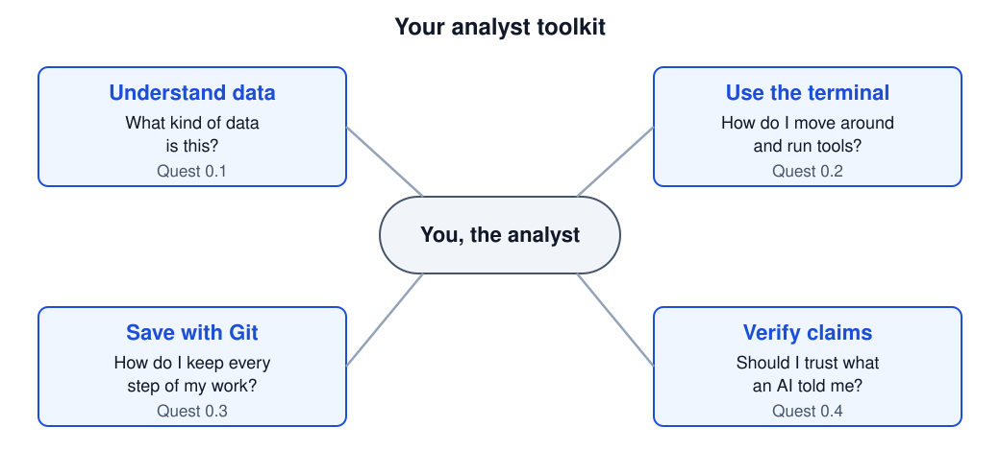

# Module 0 Conclusion

**Time:** about 5 minutes. Read this before the Boss Battle (Module Project).

**Analyst toolkit:** **Understand data** · **Use the terminal** · **Save with Git** · **Verify claims** ([what's this?](introduction.md#the-big-picture-your-analyst-toolkit))

## Introduction

When this module started, you may never have opened a terminal or saved work with Git. Now you've set up a real analyst's toolkit. You can tell what kind of data you have, move around your computer by typing commands, save your work in small steps, and check an AI's answer before you use it.

**Main takeaway:** These four habits aren't extra. They're how careful analysts work every day, and you'll use all four in every module from now on.

**Why it matters at work:** Employers want analysts they can trust. These habits show that you check before you trust, and that you leave a clear record of your work.

## What you did

* **5 readings** on data types, the terminal, Git, and checking AI answers
* **4 quests** and a checkpoint
* **Your first public work on GitHub**

## What you can do now

You've now practiced every part of your [analyst toolkit](introduction.md#the-big-picture-your-analyst-toolkit):

| Toolkit part | You can now... |
| --- | --- |
| **Understand data** | Tell variables, values, data types, and data structures apart, and explain why a ZIP code isn't a number you'd do math on |
| **Use the terminal** | See where you are, move between folders, run commands, and read an error message calmly |
| **Save with Git** | Save your work in small steps with clear messages, and send it to GitHub |
| **Verify claims** | Spot an AI answer that sounds sure but has no evidence, and check it before you use it |

## How to talk about your skills

### On your resume

After the Boss Battle (Module Project), fill in the blanks with your own details:

* **Data Literacy:** "Inspected a public dataset of [row count] rows and classified each column by data type and structure."
* **Git & Version Control:** "Tracked my work with Git in small, clearly described commits, and published it on GitHub."
* **Terminal & Command Line:** "Used the command line to set up a project, move between folders, and run tools."
* **AI Literacy:** "Checked AI-generated claims against the data before using them."

### In an interview

When someone asks how you start with new data, you can use this answer:

> "First, I open the raw file and look before I assume anything. I check what kind of data each column holds. For example, a ZIP code is made of digits, but it isn't a number to do math on. I save my work in small steps with Git, so every decision has a record. And if I use an AI, I check its claims before I repeat them."

## Where these skills show up next

You'll use these habits in every module. Here's where they matter most:

| In this module, you... | Next, you'll... |
| --- | --- |
| Used the terminal to move around and run commands | Run your own Python programs from the terminal **(Module 1)** |
| Saved your work with Git and GitHub | Save every project with Git **(Modules 1, 4, and 8, and the Capstone)** |
| Told data types apart | Check the data type of every column in a real table **(Modules 1, 2, 3, and 5)** |
| Checked an AI's claims | Check code that an AI writes for you **(Modules 4 and 12)** |

## Before you move on

Can you answer these without looking back?

1. What's the difference between the terminal and the shell?
2. Why isn't a ZIP code a number you'd do math on?
3. What's the difference between a commit and a push?

Answers

1. The terminal is the window you type in. The shell (zsh on a Mac) is the program inside it that reads your command and runs it.
2. It's made of digits, but it's a label for a place. Adding or averaging ZIP codes gives a meaningless answer.
3. A commit saves a step of your work in Git on your own computer. A push sends your commits to GitHub, so others can see them.

---

**Next:** The Boss Battle (Module Project). Your instructor will share the details. After that comes [Module 1: Programming Fundamentals](../module-01/overview.md), where you'll write your first Python programs.
