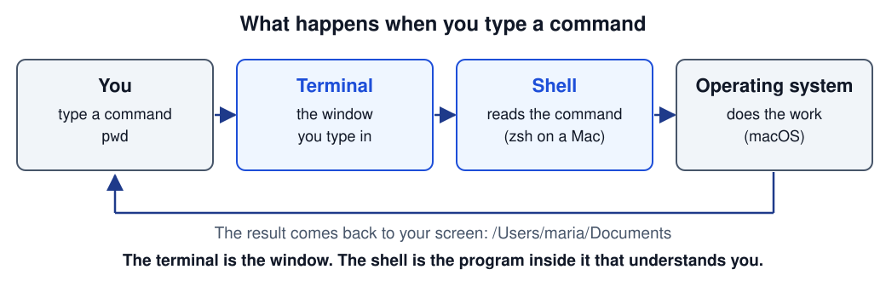

# Module 0 Introduction: Foundations

**Time:** about 15 minutes

## Where you're starting

This is the first module. You don't need any experience with code, data, or the terminal. You only need two things: curiosity, and the habit of checking your work. This module helps you build both.

## Where you're going

In this module, you'll set up the tools that every analyst (a person who studies data to answer questions) uses, and you'll learn four habits:

* Use the terminal to move around your computer and run tools.
* Look at a data file and tell what kind of data each column holds.
* Save every step of your work with Git (software that keeps a history of your files), and share it on GitHub (a website where others can see it).
* Check what an AI (artificial intelligence) tool tells you before you trust it.

## Why this matters for data work

Some values are made of digits, but they are not amounts. For example, a **ZIP code** is the number the mail service uses for one area, like `10027`. It names a place. You would never do math with it.

Say a store has two customers:

* Customer A lives in ZIP code `10027` and spent $20.
* Customer B lives in ZIP code `10001` and spent $40.

An **average** is one number that describes a usual value. To find it, add up the values, then divide by how many there are:

* Average spent = ($20 + $40) ÷ 2 = $60 ÷ 2 = **$30**. This is useful: a customer usually spends about $30.
* Average ZIP code = (10027 + 10001) ÷ 2 = 20028 ÷ 2 = **10014**. The math is right, but the answer means nothing. Neither customer lives in 10014.


An analyst who treats a ZIP code as a number can give an answer that looks right and is wrong. The habits in this module help you catch problems like this before anyone uses your work.

Analysts use these habits every day, in every data job. For example, they:

* type commands in the terminal to find files and run tools
* look at each column of a file and decide what kind of data it holds
* save their work with Git, so the team can see every change
* check an AI answer against the real data before they share it

If you skip these habits, mistakes like the average ZIP code reach the people who use your work. And the person who shares a result is responsible for it.

## The terminal and the shell

You'll use the terminal in every module, so it's worth understanding what it is.

### What is the terminal?

Most of the time, you use a computer by clicking on icons, windows, and menus. The **terminal** lets you type commands instead. Typing commands is called using the **command line**.

Analysts use the terminal because:

* **It's fast for repeated work.** One typed command can do what takes many clicks.
* **Many data tools only work this way.** You'll start Git, Python (a programming language), and databases (organized stores of data) by typing commands.
* **Many computers have no windows to click.** The computers that store and process data for companies, called **servers**, often have only a command line.

### The terminal and the shell are two different things

* The **terminal** is the window you type in. On a Mac, the app is called Terminal.
* The **shell** is the program inside that window. It reads your command, asks the computer to do the work, and shows you the result.



### bash and zsh: two shells

There's more than one shell. You'll see two names often:

| | zsh | bash |
| --- | --- | --- |
| **Full name** | Z shell | Bourne Again SHell |
| **Where you'll see it** | The shell on every new Mac. It's what your Terminal runs. | The shell on most Linux computers and servers, and the name most guides use for terminal commands. Linux is a free system that runs a computer, like macOS runs a Mac. |
| **What your prompt (the sign that the shell is ready for a command) ends with** | `%` | `$` |
| **What an error starts with** | `zsh: command not found: pdw` | `bash: pdw: command not found` |

For the commands you'll use in this program, like `cd`, `ls`, `pwd`, `mkdir`, and `git`, the two shells work the same way.


**When a guide says "bash," you can still use your Mac.** Guides and READMEs (the help file that comes with a project) often label terminal commands as `bash`. That label means "type this in a terminal." The same commands work in zsh. That's also why your projects ask you to label your terminal commands as `bash`: it's the label everyone recognizes.


To see which shell you're using, type this and press Enter:

```bash
echo $SHELL
```

On a Mac, you'll see `/bin/zsh`.

### Mac and Windows

Everyone in this program uses a Mac, so the guides you'll follow are written for a Mac. At work, you may use a Windows computer, or work with teammates who do. Here's what's different:

| | Mac | Windows |
| --- | --- | --- |
| **Terminal app** | Terminal | Windows Terminal |
| **Shell it starts with** | zsh | PowerShell (an older option is Command Prompt) |
| **A folder path looks like** | `/Users/maria/Documents` | `C:\Users\maria\Documents` |
| **Folders are separated by** | `/` (forward slash) | `\` (backslash) |
| **List the files in a folder** | `ls` | `ls` in PowerShell, `dir` in Command Prompt |
| **Running bash commands** | Works already | Install **Git Bash** (it comes with Git for Windows) or **WSL** (Windows Subsystem for Linux) |

Servers usually run Linux. Linux uses `/` in paths and runs bash, just like your Mac's terminal works. So the commands you learn on a Mac carry over to most of the computers you'll meet at work.

**Learn more:** [Apple: Terminal User Guide](https://support.apple.com/guide/terminal/welcome/mac) · [Apple: Use zsh as the default shell on your Mac](https://support.apple.com/en-us/102360) · [Microsoft: Windows Terminal](https://learn.microsoft.com/en-us/windows/terminal/) · [W3Schools: What is the command line?](https://www.w3schools.com/whatis/whatis_cli.asp)

## The big picture: your analyst toolkit

This module gives you four parts of an analyst's toolkit. Each quest (one reading) teaches one part:


| Part | The question it answers |
| --- | --- |
| **Use the terminal** | How do I move around my computer and run tools? |
| **Understand data** | What kind of data is this? |
| **Save with Git** | How do I keep every step of my work, and share it? |
| **Verify claims** | Should I trust what an AI told me? A **claim** is a statement that says something is true, which may or may not be correct. |

You'll use all four parts together, every day, in every module after this one. At the top of every quest page, you'll see which part you're on, like this:

**Analyst toolkit:** **Use the terminal** · Understand data · Save with Git · Verify claims

## What you'll be able to do

By the end of this module, you'll be able to:

* **Use the terminal:** Open the terminal, see where you are, move between folders, and read an error message calmly.
* **Understand data:** Tell variables, values, data types, and data structures apart. Explain why a column made of digits isn't always a number you'd do math on.
* **Save with Git:** Save your work in small steps with clear messages, and send it to GitHub so others can see it.
* **Verify claims:** Spot when an AI answer sounds sure but has no evidence, and check it before you use it.

## Skills you'll build

These are the skills the Boss Battle (Module Project) checks. The names in bold are the official skill names you'll see on your project's grading guide.

| Group | Skill | What it means |
| --- | --- | --- |
| **Working with data** | **Data Literacy** | Tell what kind of data you have and what you can do with it |
| | **Critical Thinking** | Ask clear questions about data before you trust it |
| | **Curiosity** | Notice something interesting in data and ask a good question about it |
| **Working with tools** | **Terminal & Command Line** | Move around your computer and run tools by typing commands |
| | **Git & Version Control** | Save every step of your work, and share it on GitHub |
| | **General Programming & Coding** | Tell a data type (like text or a whole number) apart from a data structure (like a list or a table) |
| **Working with AI** | **AI Literacy** | Explain what an AI can get wrong, and check its answers |

## The Boss Battle (Module Project)

At the end of this module, you'll get a real public dataset that you've never seen before. A **dataset** is a set of data, often one table or file. *Public* means anyone can see and use it. Your job is to be its first careful reader.

You'll open the raw file (the data as it first came, before anyone changed it) and decide what kind of data each column holds. You'll write down a good question about how the data was collected. You'll keep a record of the terminal commands you ran, save your work in small steps with Git, and publish it on GitHub.

When you finish, you'll have your first public portfolio piece (a sample of your work that you show to employers). It shows employers more than an answer: it shows how you think, check, and work. Your instructor will share the dataset and the exact requirements when the project starts.

---

**Next:** [Quest 0.1 — Meet Your Terminal: The Command Line (Day 1)](quest-01-terminal.md)

Need the map again? Go back to the [Overview of Module 0 (Read FIRST)](overview.md).
