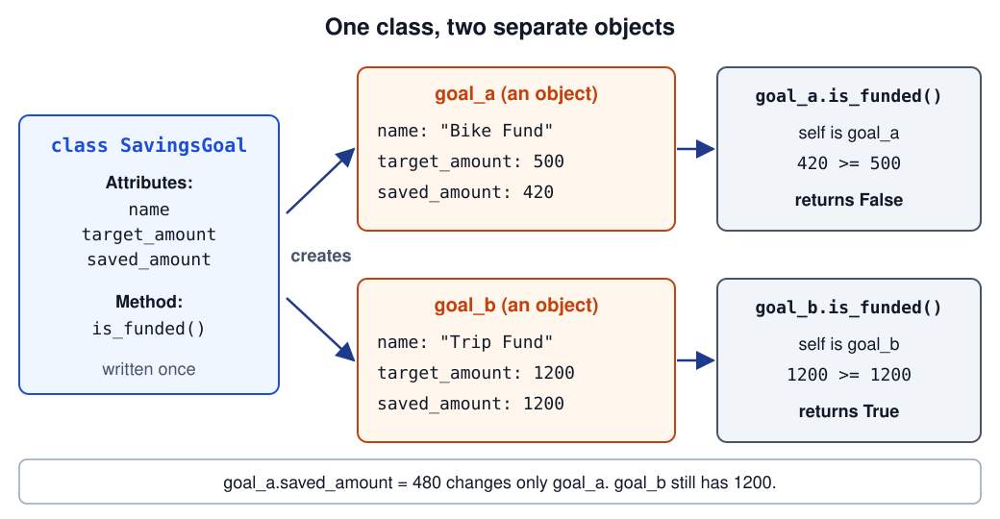

# Module 1 Checkpoint: Review and Practice (Day 19)

**Time:** About 10 minutes to read (no new reading)

**Building blocks:** **Decide and repeat** · **Organize steps** · **Hold data** · **Load, save, and protect** · **Check your work** (all five) ([what's this?](introduction.md#the-big-picture-the-building-blocks-of-a-data-program))

## Introduction

So far, each quest told you which skill to use. This page mixes them up. You'll answer questions from every quest without being told where to look. Then you'll explain two pictures from memory.

**How to use this page:** Answer each question first, with no notes and no readings. Then open the answer. If you miss one, go back to the quest in parentheses, review it, close it, and try again from memory.

**Main takeaway:** The questions you miss show you which quest to review before the Boss Battle (Module Project).

**Why it matters at work:** At work, no one tells you which skill a problem needs. You need to know what you can do on your own, and what you still need to practice.

**Skills:** Every skill from this module

## Self-check questions

**1. (Quest 1.1)** Don't run this code. What does it print?

```python
total = 0

for number in range(1, 4):
    if number > 1:
        total += number

print(total)
```

<details>
<summary>Answer</summary>

It prints `5`. `range(1, 4)` gives `1`, `2`, `3`.

* `number` is 1: `1 > 1` is False, so `total` stays 0.
* `number` is 2: True, so `total` becomes 2.
* `number` is 3: True, so `total` becomes 5.

</details>

**2. (Quest 1.2)** This function creates a local variable named `total`. After the function runs, can the rest of the script use the name `total`? Why or why not?

```python
def calculate_total(price, quantity):
    total = price * quantity
    return total
```

<details>
<summary>Answer</summary>

No. `total` is a local variable, so it exists only inside the function, while it runs. Using it outside raises a `NameError`. The function returns the *value*, not the name. To keep the value, store it: `result = calculate_total(5, 3)`.

</details>

**3. (Quest 1.4)** A delivery app needs to find a driver's name from an order code, many times a night. Each order code is unique. Should it store the data in a list or a dictionary? Why?

<details>
<summary>Answer</summary>

A dictionary, with the order code as the key and the driver's name as the value. A dictionary finds a value by its key. With a list, the app would have to check items one at a time.

</details>

**4. (Quest 1.5)** Fill in the two missing steps.

```text
Python value → ? → text in a file → ? → Python value
```

<details>
<summary>Answer</summary>

**Serialization** (saving) turns a Python value into text that can be saved to a file. **Deserialization** (loading) builds the Python value again from that text.

</details>

**5. (Quest 1.6)** The rules: each sign-up line has 3 fields (name, grade, class), and the grade must be from 9 to 12. Here, the grade is the student's year in school. Which line should be rejected, and which rule does it break?

```text
Leo,10,Art
Maya,14,Art
```

<details>
<summary>Answer</summary>

`Maya,14,Art`. It has the right shape, 3 fields, but its grade is outside 9 to 12. It's invalid input. The right number of fields doesn't make the values right.

</details>

**6. (Quest 1.6)** Is each one validation or error handling?

* **A.** A hotel program checks `nights >= 1`, because a stay must be at least one night.
* **B.** The program runs `int(nights_text)` inside `try`, and catches the `ValueError` when a guest types `"4 nights"`.

<details>
<summary>Answer</summary>

**A is validation:** it checks the data against a rule. **B is error handling:** it decides what happens when an operation fails. They work together, but each has its own job.

</details>

**7. (Quest 1.7)** A teammate wants one function that checks a week of step counts (how many steps someone walked each day), adds them up, and prints the weekly summary. What's the problem with that plan?

<details>
<summary>Answer</summary>

The function has several jobs. Give each job its own function: one checks the data, one summarizes it, and one prints it. Each one is then easier to describe in one sentence, test, fix, and reuse.

</details>

**8. (Quest 1.8)** Should `goal_b.saved_amount` change to 480? Why or why not?

```python
goal_a = SavingsGoal("Bike Fund", 500, 420)
goal_b = SavingsGoal("Trip Fund", 1200, 1200)

goal_a.saved_amount = 480
```

<details>
<summary>Answer</summary>

No. `goal_a` and `goal_b` come from the same class, but each object stores its own attributes. `goal_b.saved_amount` is still `1200`.

</details>

**9. (Quest 1.8)** A teammate says, "`__init__` runs every time I use an object." Is that right?

<details>
<summary>Answer</summary>

No. `__init__` runs once, when the object is made. Reading an attribute or calling a method later doesn't run it again.

</details>

**10. (Quest 1.8)** The `Pet` class has both `__str__` and `__repr__`. Which one does `print(biscuit)` use? Which one does `print([biscuit, mochi])` use?

<details>
<summary>Answer</summary>

`print(biscuit)` uses `__str__`, the friendly view for people. `print([biscuit, mochi])` uses `__repr__` for each item, because a list always shows its items with `__repr__`.

</details>

**11. (Quests 1.3 and 1.9)** Match each search to its Big-O, then explain both in plain words: a linear search by name, and a dictionary lookup by key. The choices are O(n) and O(1) average-case.

<details>
<summary>Answer</summary>

* **Linear search: O(n).** In the worst case, it checks every item, so the work grows with the number of items.
* **Dictionary lookup: O(1) average-case.** It takes about one step, no matter how many items there are.

Big-O describes how the work grows as the data grows. It doesn't describe who won one small timing test.

</details>

**12. (Quest 1.10)** This loop should process positions 0, 1, 2, 3, and 4. Name the bug (the mistake in the code) precisely.

```python
for index in range(4):
    process(index)
```

<details>
<summary>Answer</summary>

An off-by-one error. `range(4)` gives `0`, `1`, `2`, `3`, so position 4 is never processed. The loop runs with no error, but it does one pass too few.

</details>

**13. (Quest 1.10)** An AI (artificial intelligence) tool writes a function for you. It runs with no error, has clear names and comments, and prints a result. Is that enough to trust it? What do you do next?

<details>
<summary>Answer</summary>

No. Running without an error doesn't prove the logic is right. Work out the expected answer by hand for a small example, including an edge case, an unusual input like an empty list. Then run the function and compare. If they differ, trace the code to find the line where they split.

</details>

**14. (Quests 1.7 and 1.8)** A library program reads checkout records. A **checkout record** shows who borrowed which book, and when. The program checks each one, keeps track of each book's title and copies available, and prints a daily summary. Name one job that fits a standalone function, and one that fits a method on a `Book` class. Say why.

<details>
<summary>Example answer</summary>

Checking each checkout record fits a standalone function: it takes a record and returns whether it's valid, and it doesn't belong to any one book. Checking whether a book has copies left fits a method on `Book`, like `is_available()`, because it uses that book's own attributes. There's more than one good design. Your reason is what matters.

</details>

## Explain the picture

Look at each picture. Explain it out loud in two or three sentences, as if to a classmate. Then open the answer.

**1. (Quest 1.8)** Look at the two objects. Why does the same method give two different answers?



<details>
<summary>Answer</summary>

The `SavingsGoal` class is written once. It makes two objects, and each one stores its own attribute values. When you call `is_funded()`, `self` is the object before the dot. So the same method checks 420 against 500 for `goal_a`, and 1200 against 1200 for `goal_b`. Changing `goal_a` doesn't change `goal_b`.

</details>

**2. (Quest 1.10)** Follow both paths after step 2. What does each path tell you to do?


<details>
<summary>Answer</summary>

First, work out what the code should print, by hand: $3 + $4 + $5 + $6 + $2 = $20. Then run it. If it crashes, or stops with an error, the traceback's last line names the error and the line. If it doesn't crash, compare: it printed $17, so something is quietly wrong, here an off-by-one loop that skipped the $3 bread. After the fix, run the same example again to check that it prints $20. It's the habit from [Confidence Is Not Evidence](../module-00/quest-04-ai-verification.md): check against something real before you trust it.

</details>

## Interview practice

> **"Walk me through how you'd plan a small Python program before you start coding it."**

<details>
<summary>Example answer</summary>

First, I'd list what the program needs to do and what data it holds. Then I'd split the work into jobs, and give each job its own function. If many records share the same values and actions, I'd use a class. I'd pick containers by how I'll use the data. For example, I'd use a dictionary when I need to find things by a key. Before I build it all, I'd write a few small examples with known answers, including edge cases, so I can check each piece as I go.

</details>

## Ready for the Boss Battle (Module Project)?

You're ready when you can say "I can" to each of these:

* I can trace loops and `if` statements and predict the output without running the code.
* I can explain parameters, return values, and local scope.
* I can choose a list, tuple, dictionary, or set based on what the program needs to do.
* I can explain saving (serialization) and loading (deserialization).
* I can check input against clear rules, and tell validation apart from error handling.
* I can split a program into functions that each do one job.
* I can write a class, make independent objects, and explain when `__init__` runs.
* I can compare a linear search, O(n), with a dictionary lookup, O(1) average-case, in plain words.
* I can work out the expected answer first, then find and name a bug precisely.
* I can check code by testing it, instead of trusting that it ran.

---

**Next:** [Module 1 Conclusion (Day 19)](conclusion.md)
