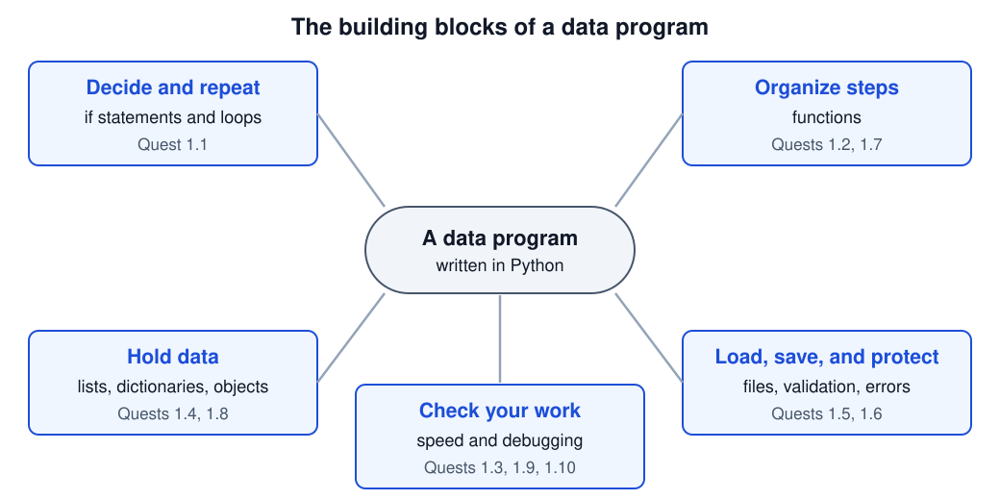

# Module 1 Conclusion (Day 19)

**Time:** about 6 minutes. Read this before the Boss Battle (Module Project).

**Building blocks:** **Decide and repeat** · **Organize steps** · **Hold data** · **Load, save, and protect** · **Check your work** ([what's this?](introduction.md#the-big-picture-the-building-blocks-of-a-data-program))

## Introduction

When this module started, you were writing your first lines of Python. Now you can write programs that make decisions, repeat steps, organize work into functions, hold data in the right container, save it to files, and keep going when the data is bad. You can also predict what code will do before you run it, and find the bug when it doesn't.

**Main takeaway:** Every program you write uses the same five building blocks. The Boss Battle (Module Project) asks you to use all five in one program.

**Why it matters at work:** Every data tool you'll use, from pandas to SQL to dashboards, is built on these ideas. If you understand them, new tools are much easier to learn.

## What you did

* **14 readings**, from decisions and loops to debugging
* **10 quests** and a checkpoint
* **Your own classes, functions, and files**, written and tested in plain Python

## What you can do now

You've now practiced every [building block of a data program](introduction.md#the-big-picture-the-building-blocks-of-a-data-program):

| Building block | You can now... |
| --- | --- |
| **Decide and repeat** | Write `if` statements and loops, and trace what they'll print before you run them |
| **Organize steps** | Write functions with parameters and return values, give each one job, and explain where each variable can be used |
| **Hold data** | Pick a list, tuple, set, or dictionary for a job, and build your own class |
| **Load, save, and protect** | Save data to a file and load it back, check incoming data, and handle errors so one bad record doesn't stop the program |
| **Check your work** | Explain how a program slows down as data grows, and find and fix bugs |

## How to talk about your skills

### On your resume

After the Boss Battle (Module Project), fill in the blanks with your own details:

* **Python, Functions & Modular Programming:** "Built a [type of program] in Python, split into small functions with one job each."
* **Attention to Detail:** "Checked every incoming record and handled bad data, so one bad line never stopped the program."
* **Object-Oriented Programming:** "Designed a `[ClassName]` class to represent each [item] and its data."
* **Algorithmic Complexity (Big-O):** "Replaced a list search with a dictionary lookup, so lookups stayed fast as the data grew."

### In an interview

When someone asks you to find a bug, you can use this answer:

> "First, I decide what the output *should* be. Then I run the code and compare. If they don't match, I trace the code line by line to find where my prediction and the real output split. Code that runs isn't always correct, so I check the answer, not just whether there's an error."

## Where these skills show up next

Nothing you learned here goes away. In the next module, you'll start using **pandas**, a Python package for tables of data. pandas is built from the same pieces you learned here:

| In this module, you... | Next, you'll... |
| --- | --- |
| Wrote functions with one job | Write one cleaning function and run it on every new file **(Module 2)** |
| Built a class and made objects from it | Use a `DataFrame`, which is a pandas class. Each table you load is a DataFrame object **(Module 2)** |
| Used attributes and methods on your own objects | Use attributes like `df.shape` and methods like `df.sort_values()` **(Module 2)** |
| Saved data to CSV and JSON files | Load a whole CSV file into a table in one line **(Module 2)** |
| Wrote loops to repeat a step for every record | Run one step on a whole column at once, with no loop **(Module 2)** |
| Handled bad values with validation and errors | Decide what to do with blank and bad values in real data **(Module 2)** |
| Tidied text with `.strip()` and `.lower()` | Tidy a whole column of text at once with `.str.strip()` and `.str.lower()` **(Module 2)** |
| Compared a list search with a dictionary lookup | Think about speed again when the data gets very large **(Modules 7 and 9)** |

From Module 3 on, every module expects you to read and write Python on your own.

## Before you move on

Can you answer these without looking back?

1. What's the difference between syntax and style?
2. What's the difference between a parameter and an argument?
3. Why is looking up a key in a dictionary faster than searching a list?

Answers

1. Syntax is the set of rules Python requires. If you break one, Python stops with an error. Style (PEP 8) is the set of habits people expect. Code with bad style still runs, but it's harder to read.
2. A parameter is a name in a function's `def` line. An argument is the value you pass in when you call the function.
3. A list search may check every item, one by one, so it gets slower as the list grows. A dictionary jumps straight to the key, so it stays fast.

---

**Next:** The Boss Battle (Module Project). Your instructor will share the details. After that comes [Module 2: Exploratory Data Analysis](../module-02/overview.md), where you'll explore real tables of data.
