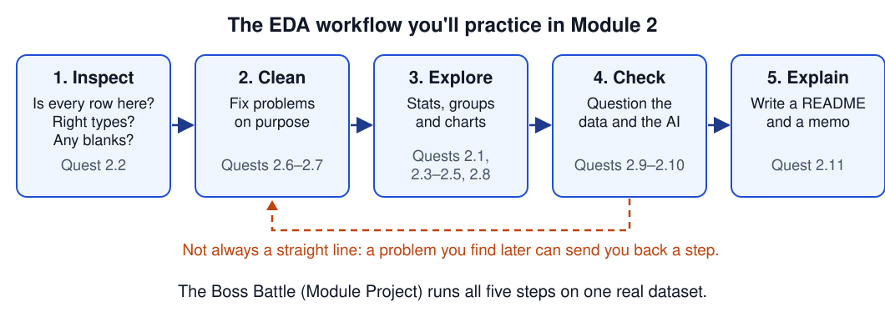

# Module 2: Exploratory Data Analysis


**In one sentence:** In Module 2, you'll take a real, messy table of data, check it, clean it, find a pattern you can trust, and explain it to someone who never saw your code.


## Where you've been

You already have the skills this module builds on:

* **Module 0** gave you working habits: the terminal, Git, knowing what kind of data you have, and checking what an AI tells you.
* **Module 1** taught you Python: loops and conditionals, functions, lists and dictionaries, classes, Big-O, error handling, and debugging.

In Module 1, your data was small lists you typed yourself. In Module 2, it's real tables with hundreds or thousands of rows.

## Where you're going

You'll learn **exploratory data analysis**, or **EDA**: getting to know a dataset before you make any claims about it. You'll use four new tools: NumPy, Jupyter notebooks, pandas, and Matplotlib.

## Why this matters for data work

Analysts spend most of their time understanding and cleaning data before any answer can be trusted.

Here's an example. A manager asks, "What does a typical insurance claim pay?" If a few huge claims pull the average up and you report it anyway, the company plans its budget around the wrong number. EDA is how you catch that before it happens.

## The big picture

Every quest in this module teaches one step of the same workflow:

## Your route

| Day | Page | You'll learn to... |
| --- | --- | --- |
| 1 | [Quest 2.1 — The Loudest Number](quest-01-descriptive-statistics.md) | Pick the number that honestly describes "typical," and measure spread |
| 2 | [Quest 2.2 — Look Before You Filter](quest-02-inspect-filter.md) | Load a file in a notebook, check it four ways, and filter rows |
| 3 | [Quest 2.3 — One Row Per Group](quest-03-group-columns.md) | Summarize groups, add new columns, and merge two tables |
| 4 | [Quest 2.4 — Who's This Chart For?](quest-04-two-kinds-of-charts.md) | Pick a chart type on purpose, and polish a chart for someone else |
| 5 | [Quest 2.5 — Real Numbers, Wrong Story](quest-05-chart-best-practices.md) | Catch charts that mislead, even when every number is real |
| 6 | [Practice Day — Stats, pandas, Charts](practice-day-06.md) | Review Days 1–5 and check code an AI wrote |
| 7 | [Quest 2.6 — Drop, Fill, or Flag](quest-06-missing-data.md) | Decide what to do with each missing value, and say why |
| 8 | [Quest 2.7 — Write It Once](quest-07-cleaning-function.md) | Put your cleaning steps in one function you can reuse |
| 9 | [Quest 2.8 — Beneath the Total](quest-08-mining-a-pattern.md) | Find a pattern you can trust by splitting the data into groups |
| 10 | [Quest 2.9 — The Pattern Isn't the Proof](quest-09-clarifying-questions.md) | Ask clear questions about where data came from |
| 11 | [Quest 2.10 — Two Sets of Eyes](quest-10-ai-on-charts.md) | Check an AI's description of a chart, and an AI's chart ideas |
| 12 | [Quest 2.11 — Nobody Was in the Room](quest-11-stakeholder-communication.md) | Write a README and a memo someone can act on |
| 13–14 | [Module 2 Checkpoint](checkpoint.md) | Find a pattern on your own, then review everything |
| 15–19 | [Boss Battle (Project)](project.md) | Run the whole workflow on one real dataset |

When you finish, read the [Module 2 Wrap-Up](wrap-up.md).

## New tools this module

Read each tool guide right before the quest that first uses it. Each one takes about 5 minutes.

| Tool | What it does | First used | Guide |
| --- | --- | --- | --- |
| NumPy | Does math on many numbers at once | Day 1 | [NumPy guide](tool-numpy.md) |
| Jupyter notebooks | Run code in small steps and see each result right below it | Day 2 | [Notebooks guide](tool-jupyter-notebooks.md) |
| pandas | Load, check, clean, and summarize tables of data | Day 2 | [pandas guide](tool-pandas.md) |
| Matplotlib | Draw charts and save them as images | Day 4 | [Matplotlib guide](tool-matplotlib.md) |

## Skills you'll be expected to show

The project is graded on these 10 skills. Each quest tells you which ones it builds.

| Skill | In plain words | Where you'll practice | How the project checks it |
| --- | --- | --- | --- |
| **Statistical Analysis** | Pick the number that fits (mean, median, standard deviation) and explain what it means | Quests 2.1, 2.3, 2.8 | You explain your key number and how spread out it is |
| **Data Distributions & Shape** | Read a column's shape: where most values sit, which way they lean, and any outliers | Quests 2.1, 2.5, 2.10 | You profile 3 columns, each with numbers and a chart |
| **Data Mining** | Find a real pattern hiding inside groups | Quests 2.3, 2.8, Checkpoint | You report one finding that isn't obvious |
| **Data Cleaning & Imputation** | Fix problems on purpose, and handle blanks with a reason | Quests 2.2, 2.6, 2.7 | You write a cleaning function and explain each drop, fill, or flag |
| **Data Visualization** | Choose a chart that fits the question, and label it honestly | Quests 2.4, 2.5 | Your charts fit their questions and appear in your README |
| **Critical Thinking** | Question the data before you trust a pattern | Quests 2.5, 2.9 | Your memo asks 2 specific, checkable questions |
| **Stakeholder Communication** | Explain a finding to someone who won't open your code | Quests 2.4, 2.11 | Your README and memo stand on their own |
| **AI as Critic** | Check an AI's description of your chart against your own numbers | Quest 2.10 | You judge each claim in an AI's read of your chart |
| **AI Evaluation** | Judge a chart or code an AI suggests before you use it | Practice Day, Quest 2.10, Checkpoint | You judge an AI-suggested chart |
| **Presentations** | Present your finding in 3–5 minutes, answer first | Project, Day 19 | Your share-out deck and talk |

The readings also track **pandas DataFrames**: reading a table's rows, columns, and data types correctly.

## The Boss Battle

On Days 15–19, you'll pick one of four real-world topics: insurance claims, hospital wait times, building permits, or a consulting firm's billed hours. You'll clean the data, profile it, find a pattern, test an AI's chart reading, and write a README and memo for a stakeholder. On the last day, you'll present your finding to a small group.

## How each quest page works

Every quest page has the same sections, in the same order:

1. **Why this matters**: why a data analyst needs this
2. **What you'll be able to do**: the goal, in "I can" statements
3. **Words to know**: the new terms, in plain words
4. **Before you read**: one warm-up question
5. **Read**: the interactive reading (about 20 minutes) and what to look for
6. **Main takeaways**: a summary, common mix-ups, and how it connects to the next quest and the project
7. **Quick check**: two questions to test yourself

Submit each reading for credit when you finish it.

---

**Start here:** [NumPy guide](tool-numpy.md), then [Quest 2.1 — The Loudest Number](quest-01-descriptive-statistics.md)
