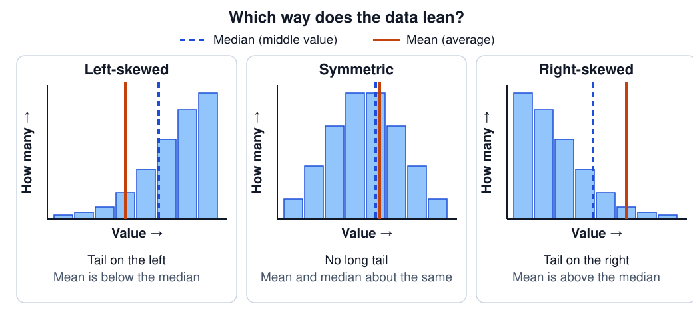
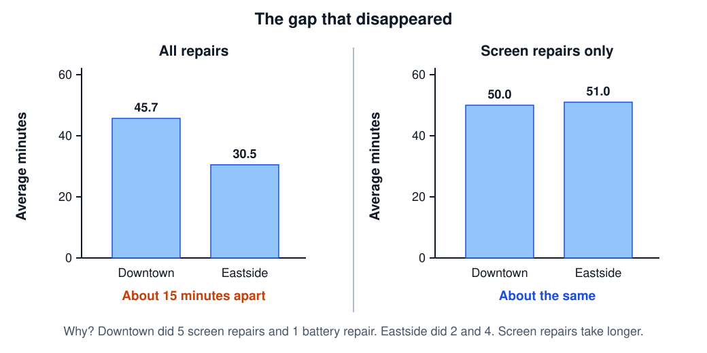

# Module 2 Checkpoint: Review and Solo Practice (Days 13–14)

**Time:** About 8 minutes to read (no new reading)

**EDA workflow:** **Inspect** → **Clean** → **Explore** → **Check** → **Explain** (all five steps) ([what's this?](introduction.md#the-big-picture-the-eda-workflow))

## Introduction

So far, you've practiced each skill with a reading, a guide, or a partner. These two days check whether you can do it on your own. You'll find a pattern in data you've never seen, then review every skill from the module.

**Main takeaway:** The questions you miss here show you which quest to review before the Boss Battle (Module Project).

**Why it matters at work:** At work, no one gives you step-by-step instructions for a new dataset. You need to know what you can do alone, and what you still need to practice.

## What happens in class

**Day 13: Find a pattern on your own (35 minutes).** You'll get a dataset you've never seen (FiveThirtyEight's Bechdel test and box office data) and find one pattern on your own. FiveThirtyEight is a news website that writes about data. The **Bechdel test** asks if a movie has two women who talk about something besides a man. **Box office** means the money a movie earns from ticket sales. Use everything from Quest 2.8: check the mix, compare the same kind of row across groups, and watch for a confound.

**Day 13: A short preview of lambda (20 minutes, slides only).** A **lambda** is a one-line function without a name:

```python
def add_tax(price):  # a regular function
    return price * 1.08

add_tax = lambda price: price * 1.08  # same, as a lambda

df["price"].apply(lambda p: p * 1.08)  # inside .apply
df["price"] * 1.08  # simpler here
```

Lambda is optional. Your cleaning steps stay in a regular `def` function. You'll use lambda more in Module 4.

**Day 14: Final practice.** Three recall questions (one from Module 1), a classmate-led cleaning code-along (everyone writes the same code together, step by step), and one more AI (artificial intelligence) check. This time, you'll check AI-written *cleaning* code for hidden problems. Use the [checklist from the Practice Day](practice-day-06.md#before-you-trust-ai-analysis-code). You first did this kind of check in [Looks Right. Is It?](../module-01/quest-10-debugging.md), where AI-written code ran with no errors but gave viewers the wrong totals.

**Skills:** Every skill from this module, with a focus on Data Mining, Critical Thinking, and AI Evaluation

## Self-check challenges

Try each one before you open the answer. If you miss one, go back to the quest in parentheses.

**1. (Quest 2.1)** A city's household incomes (the money everyone living in one home earns in a year) have a mean of $72,000 and a median of $48,000. Which do you report as "typical," and what shape is the data?

<details>
<summary>Answer</summary>

The median, $48,000. The mean is far above the median, so the data is right-skewed: a few very high incomes pull the mean up.

</details>

**2. (Quest 2.2)** `df.dtypes` shows `price` as `str`. What's probably going on, and what do you do?

<details>
<summary>Answer</summary>

Some values aren't clean numbers, like `"TBD"`. Turn the column into numbers with `pd.to_numeric(df["price"], errors="coerce")`, then count the new blanks and decide whether to drop, fill, or flag them.

</details>

**3. (Quest 2.3)** Write one line that shows the number of rows and the median `price` for each `category`.

<details>
<summary>Answer</summary>

```python
df.groupby("category")["price"].agg(["count", "median"])
```

</details>

**4. (Quests 2.4–2.5)** Your bar chart's y-axis starts at 50. What's wrong, and how do you fix it?

<details>
<summary>Answer</summary>

A bar's height is the claim (what the chart says is true), so a cut-off axis makes small differences look big. Delete the `plt.ylim(...)` line so the axis starts at zero.

</details>

**5. (Quest 2.6)** 30% of an `age` column is blank, and every blank comes from one clinic's online form. A **clinic** is a small health center where people see a doctor. Drop, fill, or flag?

<details>
<summary>Answer</summary>

Flag it. The blanks are bunched in one group, so filling them would be a guess, and dropping them would remove that clinic. Then ask the data steward (the person who looks after the data) why that form leaves age blank.

</details>

**6. (Quest 2.7)** An AI's cleaning code uses `df.drop_duplicates()` with nothing inside the parentheses. What could it miss?

<details>
<summary>Answer</summary>

Repeated records where one field changed, like a corrected count or a new spelling. Remove repeats with `subset=` set to the key column.

</details>

**7. (Quest 2.8)** Store A's average sale is $20 higher than Store B's. Before you call Store A better, what do you check?

<details>
<summary>Answer</summary>

The mix: does Store A sell more expensive kinds of items? Count the rows per store and category, then compare the same category across stores. Also check that each group has enough rows to trust.

</details>

**8. (Quest 2.9)** Rewrite "Is this data complete?" as a checkable question about a dataset of hospital wait times.

<details>
<summary>Answer</summary>

Something like: "12 hospitals have no wait time listed. Did they not report it, or were they left out of the file?" It names a number and a group, so a data steward can answer it.

</details>

**9. (Quest 2.10)** An AI says your histogram is "roughly symmetric." Your mean is 41 and your median is 28. What's your verdict (your ruling: right, wrong, or can't be checked)?

<details>
<summary>Answer</summary>

Wrong. A mean that far above the median means the data is right-skewed. Check the chart and report the median.

</details>

**10. (Quest 2.11)** What goes in the first line of your memo?

<details>
<summary>Answer</summary>

Your answer in one plain sentence, with one number and no code words. That's BLUF: Bottom Line Up Front. The "bottom line" is your main answer, so it goes first.

</details>

## Explain the picture

Look at each picture. Explain it out loud in two or three sentences, as if to a classmate. Then open the answer.

**1. (Quest 2.1)** In each shape, look at where the mean line sits next to the median line.



<details>
<summary>Answer</summary>

In left-skewed data, a tail of small values pulls the mean below the median. In symmetric data, the mean and median are about the same. In right-skewed data, a tail of big values pulls the mean above the median. When the data is skewed, report the median as the usual value.

</details>

**2. (Quest 2.8)** Compare the gap between the two shops on the left with the gap on the right.



<details>
<summary>Answer</summary>

Overall, Downtown looks about 15 minutes slower. But when you compare the same kind of repair, the shops take about the same time. The gap came from the mix: Downtown did more screen repairs, which take longer. The repair type is a confound.

</details>

## Interview practice

> **"Walk me through how you'd explore a dataset you've never seen."**

<details>
<summary>Example answer</summary>

First, I'd read the source note and run four checks: shape, data types, blanks, and duplicates. Then I'd clean on purpose, with a function, and give a reason for every drop, fill, or flag. Next, I'd look at each key column's shape before picking the mean or the median, and split the numbers by group to look for a pattern, checking each group's mix and size. Before I trusted anything, I'd write checkable questions about where the data came from. Finally, I'd explain it in a README and a memo, leading with the answer.

</details>

## Ready for the Boss Battle (Module Project)?

You're ready when you can say "I can" to each of these:

* I can run four checks on a new file and write down what each one found:
  * shape
  * data types
  * missing values
  * duplicates
* I can write a cleaning function and call it on more than one input.
* I can decide to drop, fill, or flag, and give a reason with a number.
* I can pick the mean or the median by looking at a column's shape first.
* I can choose a chart that fits the question, and label it so it doesn't mislead.
* I can find a pattern across groups and rule out a confound.
* I can write two checkable questions about a dataset.
* I can check an AI's chart reading claim by claim.
* I can write a README and a memo that someone can act on without my code.

Many of these skills grew out of earlier modules:

* **The four checks** grew out of [What Kind of Data Is This?](../module-00/quest-02-data-literacy.md), where you named data types. They also grew out of [Validate, Catch, Keep Going](../module-01/quest-06-validation-errors.md), where you checked each record.
* **A cleaning function** follows the one-job rule from [One Job at a Time](../module-01/quest-07-second-function.md).
* **Checking an AI claim by claim** uses the steps from [Confidence Is Not Evidence](../module-00/quest-04-ai-verification.md):
  * find the claim
  * find a source
  * compare the two
  * decide
* **Sharing a README** uses `git add`, `git commit`, and `git push` from [Save the Story of Your Work](../module-00/quest-03-git.md).

---

**Next:** [Module 2 Conclusion (Day 14)](conclusion.md)
