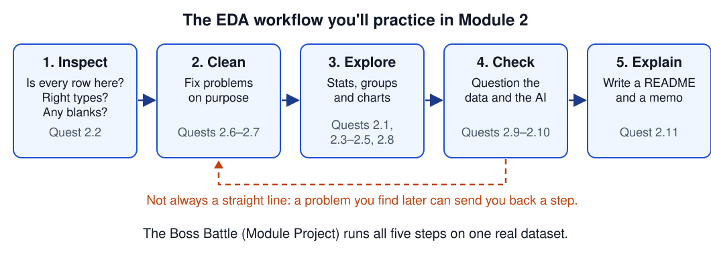

# Module 2 Conclusion

**End of Day 14** · Read before the Boss Battle (Module Project) · Time: about 6 minutes

## Introduction

Look at how far you've come. When this module started, your data was a short list you typed yourself. Now you can take a real, messy table and check it, clean it, and describe it. You can find a pattern you can trust, and explain it to someone who will never read your code. That's the core of a data analyst's job.

**Main takeaway:** Every skill from this module is one step in the same workflow. The Boss Battle (Module Project) asks you to run the whole workflow on your own.

**Why it matters at work:** Employers don't ask what modules you finished. They ask what you can do and how you did it. This page helps you say it.

## What you did

* **11 readings**, from descriptive statistics to writing for stakeholders
* **5 Data Challenges** on real public data, from college majors to airline safety
* **1 solo lab** on a dataset you'd never seen
* **2 review days** where you checked AI-written code for hidden problems

## What you can do now

You've now practiced every step of the [EDA workflow](introduction.md#the-big-picture-the-eda-workflow):

| Workflow step | You can now... |
| --- | --- |
| **Inspect** | Load any CSV in a notebook and check its shape, data types, blanks, and duplicates |
| **Clean** | Remove repeats by key, fix text that should be numbers, tidy labels, and drop, fill, or flag blanks with a reason, all in a reusable function |
| **Explore** | Pick the mean or the median by looking at the shape, summarize groups, choose a chart that fits, and find a pattern that isn't obvious |
| **Check** | Ask checkable questions about where data came from, and judge an AI's claims against your own numbers |
| **Explain** | Write a README and a memo that stand on their own, and lead with the answer |

## How to talk about your skills

### On your resume

After the Boss Battle (Module Project), fill in the blanks with your own project's details and numbers:

* **Data Cleaning & Imputation:** "Cleaned a dataset of [row count] rows in pandas: removed duplicate records, converted text fields to numbers, and documented every missing-value decision."
* **Statistical Analysis and Data Distributions & Shape:** "Profiled [number] key variables with summary statistics and histograms, and reported medians where the data was skewed."
* **Data Mining:** "Found a non-obvious pattern in [topic] by comparing groups across two columns and ruling out a confound."
* **Data Visualization and Stakeholder Communication:** "Explained findings to a [stakeholder role] with labeled charts and specific, checkable questions about the data."
* **AI Evaluation:** "Checked an AI tool's chart interpretation claim by claim against my own statistics, and corrected its errors."

### In an interview

When someone asks about a finding, use this four-part answer from [The Loudest Number](quest-01-descriptive-statistics.md):

> "I noticed **___**. The numbers show **___**. That means **___**. One caveat is **___**."

For example: "I noticed Downtown's repairs took 15 minutes longer. The numbers show Downtown did mostly screen repairs, and for screen repairs both shops took about 50 minutes. That means the location wasn't the problem. One caveat is that it was only one week of data."

## Where these skills show up next

**First, in the [Boss Battle (Module Project)](introduction.md#the-boss-battle-module-project).** You'll run all five steps on one real dataset, on your own: inspect, clean, explore, check, and explain. Your instructor will share the project details.

**Then, in the modules after this one.** Nothing you learned here goes away. It comes back in new tools.

| In this module, you... | Next, you'll... |
| --- | --- |
| Kept only the rows you needed with a filter | Filter rows with `WHERE` in SQL **(Module 3)** |
| Summarized groups with `groupby` | Summarize groups with `GROUP BY` in SQL **(Module 3)** |
| Combined two tables on a shared column with `merge` | Combine tables with `JOIN` in SQL **(Module 3)** |
| Saw missing values as `NaN` | See them as `NULL` in a database **(Module 3)** |
| Used pandas on CSV files | Use pandas on data pulled from a database **(Module 4)** |
| Described the shape and spread of your data | Measure how sure you can be about a result **(Module 5)** |
| Made charts that explain a finding to one person | Build dashboards in Excel and Tableau **(Module 6)** |

**SQL** is a language for asking questions of a database, a large, organized store of tables. You'll meet it in Module 3.

The habits come with you too: check before you trust, give a reason for every decision, and lead with the answer.

## Before you move on

Can you answer these without looking back?

1. Why can't you trust an average until you know the data's shape?
2. What two things do you check after every merge?
3. What makes a question about data "checkable"?

Answers

1. Outliers and skew pull the mean away from what's typical. Look at the shape, then pick the mean or the median.
2. The row count before and after, and the number of blanks in the new column.
3. It names a specific group, number, or method, so a data steward could answer it with a fact.

---

**Next:** The Boss Battle (Module Project). Your instructor will share the details. After that comes Module 3, SQL & Relational Databases, where you'll ask the same kinds of questions in a database.
