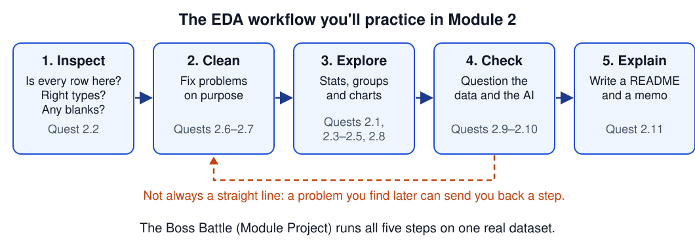

# Module 2 Introduction: Exploratory Data Analysis

**Time:** about 6 minutes

## Where you've been

You already have the skills this module builds on:

* **Working habits:** You used the terminal and Git. You learned to tell what kind of data you have. You also checked what an AI told you before you trusted it.
* **Python:** You wrote loops, conditionals, functions, and classes. You used lists and dictionaries. You saved data to files, handled errors, and fixed bugs.

Until now, your data was short lists that you typed yourself. In this module, you'll work with real tables that have hundreds or thousands of rows.

## Where you're going

You'll learn **exploratory data analysis**, or **EDA**. EDA means getting to know a dataset before you say anything about it. You'll check a table for problems and clean it. Then you'll describe it with numbers and charts, find a pattern you can trust, and explain it to someone who will never read your code.

You'll also learn four new tools that analysts use every day: NumPy, Jupyter notebooks, pandas, and Matplotlib.

## Why this matters for data work

Analysts spend most of their time understanding and cleaning data. Only then can they trust their answers.

For example, a manager at an insurance company asks you how much a claim usually pays. A few claims are very large, and they pull the average up. If you report that average, the company may plan its budget around the wrong number. EDA helps you catch problems like this before anyone makes a decision.

## The big picture: the EDA workflow

A **workflow** is a set of steps you follow in order. EDA has five steps. Each quest (one day's reading) teaches one of them:

| Step | The question you ask |
| --- | --- |
| **1. Inspect** | Did all the data arrive, and is it the right kind? |
| **2. Clean** | What's wrong with the data, and how do I fix it on purpose? |
| **3. Explore** | What do the numbers and charts show? Is there a pattern? |
| **4. Check** | Can I trust this pattern? Can I trust what the AI said? |
| **5. Explain** | How do I tell someone what I found, so they can act on it? |

At the top of every quest page, you'll see which step you're on, like this:

**EDA workflow:** Inspect → Clean → **Explore** → Check → Explain

## What you'll be able to do

By the end of this module, you'll be able to:

* **Inspect:** Open a data file and check how many rows it has, what kind of data each column holds, what's missing, and what's repeated.
* **Clean:** Fix repeated rows, numbers saved as text, and messy labels. Decide what to do with each blank, and give a reason. Put all your fixes in one function you can use again.
* **Explore:** Pick the right number to describe your data. Summarize groups. Choose a chart that fits your question. Find a pattern that isn't obvious.
* **Check:** Ask clear questions about where the data came from. Check an AI's claims against your own numbers.
* **Explain:** Write a short page that someone can act on without reading your code, and share your answer first.

## Skills you'll build

These are the skills employers look for. They're also the skills the Boss Battle (Module Project) checks. The names in bold are the official skill names you'll see on your project's grading guide.

| Group | Skill | What it means |
| --- | --- | --- |
| **Working with numbers** | **Statistical Analysis** | Pick the right number (mean, median, standard deviation) and explain what it means |
| | **Data Distributions & Shape** | Describe how values are spread out, which way they lean, and any values far from the rest |
| | **Data Mining** | Find a real pattern hiding inside groups |
| **Preparing data** | **Data Cleaning & Imputation** | Fix problems on purpose, and handle blanks with a reason |
| **Showing and telling** | **Data Visualization** | Choose a chart that fits the question, and label it honestly |
| | **Stakeholder Communication** | Explain a finding to someone who won't read your code |
| | **Presentations** | Share a finding out loud, answer first |
| **Thinking critically** | **Critical Thinking** | Question the data before you trust a pattern |
| | **AI as Critic** | Check an AI's description of your chart against your own numbers |
| | **AI Evaluation** | Judge a chart or code that an AI suggests before you use it |

## The Boss Battle (Module Project)

Everything in this module leads here. At the end of the module, you'll get a real, messy dataset from the real world, and a person who needs an answer from it. This person is your **stakeholder**: someone who will use your answer to make a decision.

You'll be the analyst. On your own, you'll run all five workflow steps: inspect the data, clean it, explore it, check your pattern, and explain what you found. Then you'll present it.

When you finish, you'll have a real project you can show employers. It will show that you can take messy data and turn it into an answer someone can trust. Every quest in this module gives you one piece of what you need. Your instructor will share the dataset choices and the exact requirements when the project starts.

---

**Next:** [Quest 2.1 — The Loudest Number: Descriptive Statistics (Day 1)](quest-01-descriptive-statistics.md)

Need the map again? Go back to the [Overview of Module 2 (Read FIRST)](overview.md).
