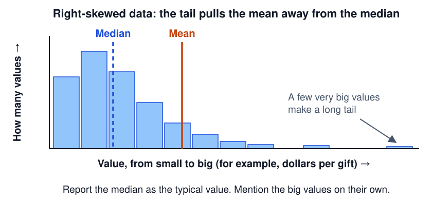

# Quest 2.1 — The Loudest Number (Day 1)


**In one sentence:** One far-off value can drag the average a long way, so you look at the data's shape before you pick the number that describes "typical."


## Why this matters

"What's a typical value?" and "How spread out are the values?" are two of the most common questions an analyst gets. Reports, budgets, and job interviews all ask them. If you answer with the wrong number, people make plans around something that isn't true.

## What you'll be able to do

* I can find the mean, median, and mode, and explain which one describes "typical" for a set of numbers.
* I can describe how spread out data is with the standard deviation and the five-number summary.
* I can tell whether data is skewed, and keep a real outlier while reporting it on its own.

**Skills:** Statistical Analysis · Data Distributions & Shape
**New tool today:** NumPy. Read the [NumPy guide](tool-numpy.md) first (5 minutes).

## Words to know

| Word | What it means |
| --- | --- |
| **Mean** | Add every value, then divide by how many there are. One far-off value pulls it toward itself. |
| **Median** | The middle value once the values are sorted. One far-off value barely moves it. |
| **Mode** | The value that shows up most often. |
| **Standard deviation** | The typical distance between a value and the mean. Small means close together. Large means spread out. |
| **Quartile** | One of three values that split sorted data into four equal groups: Q1, the median, and Q3. |
| **Five-number summary** | The minimum, Q1, median, Q3, and maximum. |
| **Skew** | The way values lean. A long tail on one side pulls the mean away from the median. |
| **Outlier** | A value far from the rest. It can still be real. |

## Before you read

A fundraising dinner gets 11 gifts. Ten guests give between $40 and $75. One company gives $5,000. One number says the typical gift is $505. Another says $55. Which one describes the people in the room?

Answer

$55. Only one of the 11 gifts is anywhere near $505. The reading shows you why, and how to explain it.

## Read

**[Start the reading: The Loudest Number in the Room →](https://the-marcy-lab-school.github.io/DA_Curriculum_Readings/Mod2/descriptive-statistics/reading-1-loudest-number/)** (about 20 minutes)

As you read, look for:

1. Why the mean and the median give such different answers for the same gifts.
2. Which number in the five-number summary flags something unusual.
3. Why the $5,000 gift stays in the data even though it distorts the mean.

## Main takeaways

### Summary

* **Every number answers one of two questions:** what is typical (mean, median, mode), or how spread out is it (standard deviation, five-number summary)?
* **Look at the shape, then pick the number.** On skewed data, the median describes a typical value better than the mean.
* **Keep a real outlier.** Report the median as typical, and mention the outlier on its own line.

### Common mix-ups

| If you think... | What's actually true |
| --- | --- |
| "The mean uses every value, so it's always the most honest." | On skewed data, the mean gets pulled toward the tail and stops describing a typical value. |
| "Delete the outlier so the mean looks right." | A real value stays in the data. Pick the median instead, and name the outlier separately. |
| "A big standard deviation means the data has lots of variety." | It can also mean one far-off value. The five-number summary shows which one you have. |

### How this connects

* **Next quest:** You'll ask the same two questions about whole columns in a table, using pandas.
* **Boss Battle:** You'll profile 3 columns, answer your stakeholder with the statistic that fits each column's shape, and explain what your standard deviation means in plain words.

## Quick check

**1.** Nine people at a small company earn between $45,000 and $60,000 a year. The owner earns $900,000. Which number should describe a typical salary?

Answer

The median. The owner's salary pulls the mean far above what almost everyone earns.

**2.** A column's mean is 30 and its median is 22. What does that suggest?

Answer

The data is right-skewed. A few big values pull the mean above the median, so the median is the better "typical" number.

---

**Next:** [Notebooks guide](tool-jupyter-notebooks.md) and [pandas guide](tool-pandas.md), then [Quest 2.2 — Look Before You Filter](quest-02-inspect-filter.md)
