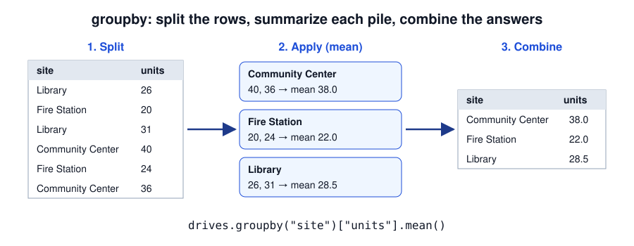

# Quest 2.3 — One Row Per Group (Day 3)


**In one sentence:** `groupby` turns hundreds of rows into one summary per group, which is how most findings start.


## Why this matters

Managers rarely ask about one row. They ask, "Which location collects the most?" or "Which team is slowest?" To answer, you compare groups. You'll also add new columns that show what raw counts hide, and pull in information from a second table, which analysts do every day.

## What you'll be able to do

* I can summarize a column for each group with `groupby` and `.agg()`.
* I can add a new column calculated from other columns, and change rows in the original table safely.
* I can merge in columns from a lookup table and check that the merge worked.

**Skills:** Data Mining · pandas DataFrames

## Words to know

| Word | What it means |
| --- | --- |
| **groupby** | Splits rows into groups by a category, then summarizes each group. |
| **Aggregation** | A summary worked out for each group, such as a count, mean, or median. |
| **Derived column** | A new column calculated from columns you already have, for every row at once. |
| **Chained assignment** | Changing a value in two steps, like `df[mask]["col"] = value`. In pandas 3, it changes a copy, not your table. |
| **`.loc`** | Picks rows and a column in one step, so a change sticks: `df.loc[rows, "col"] = value`. |
| **Merge** | Combines two tables by matching rows on a shared column, called the key. |
| **Lookup table** | A small table with one row per key, used to add columns to a bigger table. |

## Before you read

A nonprofit has 800 rows, one per blood drive, at three locations. You want to know which location collects the most blood. Would you write one filter for each location?

Answer

You could, but `groupby` does it in one line, for every location at once, however many there are.

## Read

**[Start the reading: One Row Per Group →](https://the-marcy-lab-school.github.io/DA_Curriculum_Readings/Mod2/pandas-group-columns/reading-1-one-row-per-group/)** (about 20 minutes)

As you read, look for:

1. Why the count for one site comes out lower than the number of drives it held.
2. Why changing filtered rows in two steps leaves the original table unchanged.
3. What the two checks after a merge catch that an error message doesn't.

## Main takeaways

### Summary

* **`groupby` splits, applies, and combines.** Keep the count next to the mean and median, so you can spot a group too small to trust. `count` skips blanks.
* **A filter gives you a copy.** To change rows in the original table, use `df.loc[rows, "column"] = value` in one step.
* **After every merge, check two things:** the row count before and after, and the number of blanks in the new column. Keys must match letter for letter.

### Common mix-ups

| If you think... | What's actually true |
| --- | --- |
| "Adding `.copy()` makes a two-step change stick." | It still changes a copy. Use `.loc` in one step. |
| "The merge ran with no error, so it worked." | A misspelled key leaves blanks silently. Count the blanks to find out. |
| "`groupby("site")` on its own shows a table." | It only makes the groups. You still need a summary like `.mean()` or `.agg()`. |

### How this connects

* **Next quest:** You'll turn group summaries like these into charts.
* **Boss Battle:** Part 2b asks you to add at least one new column, like `total_paid`. Part 4 asks for a `groupby` table that compares each group with the overall number.
* **Module 3:** SQL's `GROUP BY` and `JOIN` do the same jobs as `groupby` and `merge`.

## Quick check

**1.** What does `drives.groupby("site")["units"].agg(["count", "mean"])` give you?

Answer

One row per site, showing how many drives had a units value (count) and the average units (mean) for that site.

**2.** Your lookup table spells a site "Firehouse," but your main table says "Fire Station." What happens after a left merge?

Answer

The merge runs with no error. Every Fire Station row stays in the table, but with a blank in the new column. Counting blanks after the merge is how you'd catch it.

---

**Next:** [Matplotlib guide](tool-matplotlib.md), then [Quest 2.4 — Who's This Chart For?](quest-04-two-kinds-of-charts.md)
