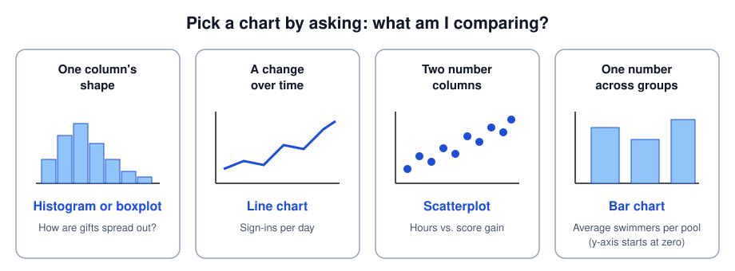

# Quest 2.4 — Who's This Chart For? (Day 4)


**In one sentence:** Some charts are rough and just for you, and some are polished for someone else. Pick the chart type by asking what you're comparing.


## Why this matters

Every chart you share at work gets judged by someone who never saw your notebook. If the chart type doesn't fit the question, or the title doesn't say what you found, the reader can miss your point or believe the wrong thing.

## What you'll be able to do

* I can tell an exploratory chart (for me) apart from an explanatory chart (for a stakeholder).
* I can choose a chart type by asking what I'm comparing.
* I can turn a text column into real dates and chart a count over time.

**Skills:** Data Visualization · Stakeholder Communication
**New tool today:** Matplotlib. Read the [Matplotlib guide](tool-matplotlib.md) first (5 minutes).

## Words to know

| Word | What it means |
| --- | --- |
| **Exploratory chart** | A quick, rough chart you make for yourself to find a pattern. |
| **Explanatory chart** | A polished chart that tells a stakeholder one clear finding. |
| **Stakeholder** | The person a finding is for, who wasn't there while you explored. |
| **Correlation** | A number from -1 to 1 for how closely two number columns move together. Near 0 means a weak link. |
| **Scatterplot** | One dot per row, with one number column across and another up the side. |
| **Line chart** | Points joined in order, to show change over time. |
| **Datetime** | A column type that stores real dates and times, so you can pull out the day or month. |

## Before you read

Which title tells a reader more: "Hours vs. Score Gain" or "More tutoring hours went with slightly bigger gains"?

Answer

The second. It states the finding. The first only names the columns, so the reader has to work out the point alone.

## Read

**[Start the reading: Who's This Chart For? →](https://the-marcy-lab-school.github.io/DA_Curriculum_Readings/Mod2/exploratory-vs-explanatory-charts/reading-1-whoschartisfor/)** (about 20 minutes)

As you read, look for:

1. The three changes that turn a rough chart into a chart for someone else.
2. Why you check `.corr()` before you trust a chart, or an AI's words about it.
3. The steps that turn sign-in times into a count of sign-ins per day.

## Main takeaways

### Summary

* **Exploratory charts are for you:** fast and rough. **Explanatory charts are for a stakeholder:** one finding, a title that states it in under 10 words, axis labels with units, and nothing extra.
* **Check a number before you trust a picture.** A correlation of 0.26 is weak, so say "tended to," not "strong."
* **Pick the chart by what you're comparing.** To chart a count over time: `pd.to_datetime`, group by `.dt.date`, `.size()`, then `.plot()`.

### Common mix-ups

| If you think... | What's actually true |
| --- | --- |
| "A good title names the columns." | A good title states the finding. Column names belong on the axes. |
| "A weak correlation means the chart failed." | A weak link is still a finding. Describe it honestly. |
| "Grades 6, 7, and 8 are in order, so use a line chart." | You're comparing groups, so use a bar chart. Lines are for change over time. |

### How this connects

* **Next quest:** You'll check these same chart types for honesty: where the axis starts, and what the chart leaves out.
* **Boss Battle:** In Parts 3–5, you'll choose a chart type for each question and say why. At least one finished chart goes in your README.

## Quick check

**1.** The director wants to know whether students who read more books at home gain more points. Which chart fits?

Answer

A scatterplot. You're comparing two number columns: books read and points gained.

**2.** You paste a rough chart into an AI chat. It says, "There's a strong relationship." Your `.corr()` shows 0.26. What do you write?

Answer

That the two tended to rise together, but the link is weak. Your number settles the claim, not the AI's wording.

---

**Next:** [Quest 2.5 — Real Numbers, Wrong Story](quest-05-chart-best-practices.md)
