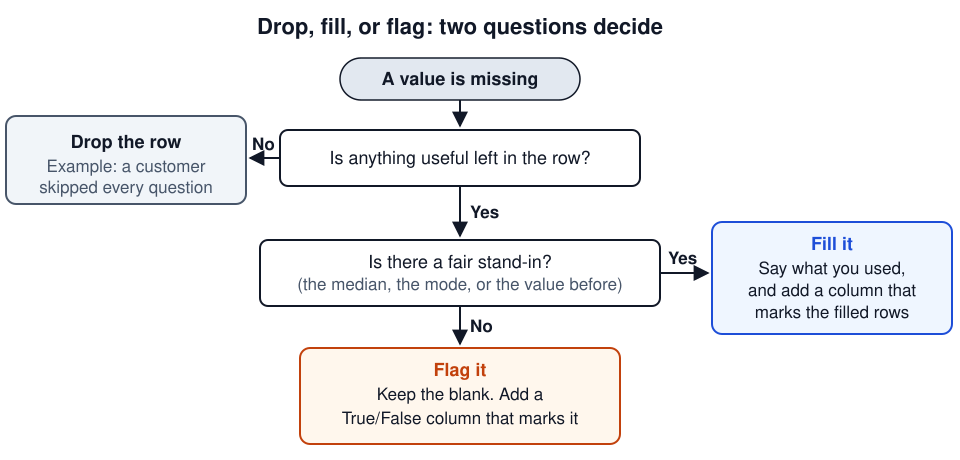

# Quest 2.6 — Drop, Fill, or Flag (Day 7)


**In one sentence:** Every blank in your data needs a decision, drop the row, fill the gap, or flag it, and a reason you can back up with a number.


## Why this matters

Real data almost always has gaps. What you do with them changes every total and average in your report. "I dropped the nulls" isn't a reason, and a teammate, a manager, or an interviewer will ask you why.

## What you'll be able to do

* I can count missing values and ask why they're missing and where.
* I can choose drop, fill, or flag for each gap and explain the choice with a number.
* I can pick the right stand-in for a fill: mean, median, mode, forward-fill, or backward-fill.

**Skills:** Data Cleaning & Imputation · Statistical Analysis

## Words to know

| Word | What it means |
| --- | --- |
| **NaN** | How pandas shows an empty cell, in number and text columns. |
| **Drop** | Remove a row entirely. Right when the row has nothing left to use. |
| **Fill** | Replace a missing value with a stand-in: the mean, median, mode, or a nearby value. |
| **Flag** | Leave the value blank, and add a True/False column that marks it. |
| **Mode** | The value that shows up most often. The usual fill for a category column. |
| **Forward-fill** | Fill a gap with the value just before it in order, like yesterday's number. |
| **Backward-fill** | Fill a gap with the value just after it in order, like tomorrow's number. |

## Before you read

A dog-walking app's log has 8 walks. The app crashed during 2 of them, so every field in those rows is blank. If you run `walks.dropna()`, how many rows do you expect to keep?

Answer

You might expect 6. The reading shows you get only 4, because `dropna()` with no settings also drops rows that are missing just one value. You'll see how to drop only the rows you mean to.

## Read

**[Start the reading: Drop, Fill, or Flag →](https://the-marcy-lab-school.github.io/DA_Curriculum_Readings/Mod2/missing-data/reading-1-dropfillorflag/)** (about 19 minutes)

As you read, look for:

1. The two questions to ask about every gap before you decide anything.
2. Why filling with the mode would just be a guess for the dog sizes.
3. Which fill puts a number into Lee's missing days that's longer than almost every real walk.

## Main takeaways

### Summary

* **Count the gaps first** with `.isna().sum()`. Then ask *why* each one is missing (never collected, or lost?) and *where* (spread out, or bunched in one group?).
* **Drop a row only when nothing useful is left,** and use `subset=` so rows with real values survive.
* **Fill when a fair stand-in exists, and flag when a fill would be a guess.** You can do both: flag the rows first, then fill them, so readers know which values were filled in. Always say which rows, why, and how many.

| Fill with | Fits best when |
| --- | --- |
| Mean | Values are balanced, with no outliers |
| Median | Data is skewed or has real outliers |
| Mode | The column holds categories, and one value clearly repeats the most |
| Forward-fill (`.ffill()`) | Rows are in order, and each value is close to the one before it |
| Backward-fill (`.bfill()`) | Rows are in order, and the first row is blank |

### Common mix-ups

| If you think... | What's actually true |
| --- | --- |
| "`dropna()` cleans the data." | With no `subset=`, it throws away every row with any blank, including real records. |
| "Fill with the mean, since it uses every value." | One outlier, like a 95-minute hike, pulls the mean too high. Use the median for skewed data. |
| "`.isna()` finds every missing value." | It misses placeholders like `0` or `"unknown"` typed in place of a real value. Look at the rows too. |

### How this connects

* **Next quest:** You'll put these choices into a cleaning function, so the same decisions run on every new file.
* **Boss Battle:** Part 2 asks for a drop, fill, or flag decision with a written reason. Handle placeholder values *before* you compute any statistics.

## Quick check

**1.** 3 of 40 walks are missing miles because a phone lost GPS. Their minutes are fine. Most walks are 1 to 2 miles, but one hike was 9 miles. What's the best plan?

Answer

Fill the 3 gaps with the median miles, and add a flag column that marks them. The median isn't pulled up by the 9-mile hike, and the flag shows which values were filled in.

**2.** A teammate writes, "I dropped the nulls." What's missing from that reason?

Answer

Which rows, why they were empty, and how many. For example: "I dropped 2 rows where the app crashed. Both were blank in every field, so nothing usable was lost."

---

**Next:** [Quest 2.7 — Write It Once](quest-07-cleaning-function.md)
