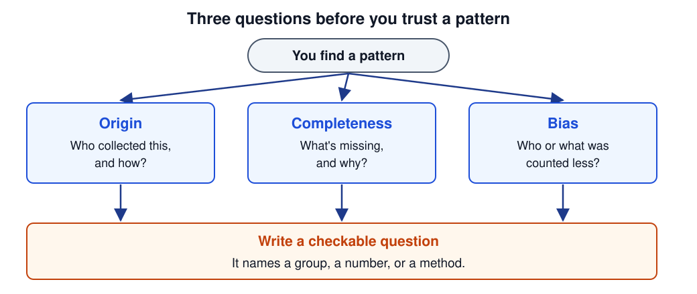

# Quest 2.9 — The Pattern Isn't the Proof: Asking Questions About Your Data (Day 10)

**Total time:** about 30 minutes

**EDA workflow:** Inspect → Clean → Explore → **Check** → Explain ([what's this?](introduction.md#the-big-picture-the-eda-workflow))

## Introduction

Sometimes a pattern in a file tells you more about how the data was collected than about the real world. For example, a review app (an app where people rate places) shows that one neighborhood has very few highly rated restaurants. Maybe the food there is worse. Or maybe fewer people there use the app, so fewer reviews were written.

In this reading, you'll learn how to:

* read the note that comes with a dataset
* check where the data came from, what's missing, and which groups were counted less
* turn an unclear question into one that someone can actually answer

**Main takeaway:** A pattern can be real in the file but wrong about the world. Before you trust it, ask specific questions about where the data came from.

**Why it matters at work:** People collect data, and they make choices and leave gaps. If you act on a pattern that the collection process created, money and effort go to the wrong place. Clear, answerable questions help you catch this before anyone makes a decision.

## Learning goals

After this reading, you should be able to say:

* I can read a dataset's source note and name the questions it leaves open.
* I can check data for Origin, Completeness, and Bias, and count rows and blanks by group in code.
* I can turn a vague question into a checkable one that a data steward (the person who looks after the data) could answer.

**Skills:** Critical Thinking

## Quick recall

You've checked a claim against its source, and you've counted blanks and group sizes. This reading turns those checks on the data file itself.

* Recall that you counted the blanks in a dog-walking log with `walks.isna().sum()`, then asked why each gap was missing and whether the gaps were bunched in one group, in the interactive reading for [Drop, Fill, or Flag](quest-06-missing-data.md). This reading counts the blanks for each group in one line.
* Recall that one unusual value moves a small group's average a lot, so you checked how many rows each group had before trusting it, in [Beneath the Total](quest-08-mining-a-pattern.md).
* Recall that in [Confidence Is Not Evidence](../module-00/quest-04-ai-verification.md), you checked a chatbot's claim against a **source**: where information comes from. This time, you ask where the data file itself came from.

## Words to know

### Where the data came from

| Word | What it means |
| --- | --- |
| **Source note** | The short document that comes with a dataset. It says who collected the data, when, and how. Read it first. |
| **Data steward** | The person or team who looks after the data and can answer questions about it. In the reading, it's the volunteer who organized the count. |
| **Sample** | The part of the whole that actually got counted. Volunteers counted trees on the blocks (city areas between streets) they picked, not every tree in town. |

### The three-part checklist

| Word | What it means |
| --- | --- |
| **Origin** | Who collected this, and how? Example: a middle-school club counted South on one rainy morning. |
| **Completeness** | What's missing, and why? Example: a tree with no species (kind of tree, like oak or maple) written down. |
| **Bias** | Who or what got **under-sampled**, meaning counted less than the rest? Example: volunteers walked many blocks in one area and only a few in another. |

### Asking good questions

| Word | What it means |
| --- | --- |
| **Checkable question** | A question specific enough that a data steward could answer it with a real fact. It names a group, a number, or a method, and ties to something you found. |
| **Generic question** | A question that could fit any dataset, like "Is this data accurate?" It sounds careful, but nobody can answer it. |

A generic question is like asking a chatbot "Are you sure?" In [Confidence Is Not Evidence](../module-00/quest-04-ai-verification.md), that got you a new claim, not a fact. A checkable question gets you a fact.

### Counting by group in code

| Word | What it means | Units |
| --- | --- | --- |
| **`.value_counts()`** | Lists each different value in a column with how many rows have it, biggest first. | Rows |
| **`trees["species"].isna().groupby(trees["area"]).sum()`** | Counts the blanks in one column for each group of another column. `.isna()` marks each blank True, `.groupby(trees["area"])` splits those by area, and `.sum()` adds them up. True counts as 1. | Blank cells |

You've used both tools before. `.value_counts()` showed "Kenya" spelled more than one way in [Write It Once](quest-07-cleaning-function.md). The `groupby` is the same split, apply, combine from [One Row Per Group](quest-03-group-columns.md), now on True/False values.


**Who can answer it?** Some checkable questions the file can answer with code, like "How many West rows are there?" Others only the source note or the data steward can answer, like "Which blocks did West's volunteers pick?"


## Before you read

In the reading, you'll focus on a street tree count. Volunteers counted trees in four parts of town, and the neighborhood association (a group of neighbors who work to improve their area) will plant new trees where the file shows the fewest. That's West, with only 2 trees.

Think about: does West really have the fewest trees, or could something else explain that number? Write down your first answer, then see if the reading agrees.

## Read

As you read, look for:

1. What the source note answers, and what it leaves open.
2. Why a total of 4 blanks hides something that a count by group shows.
3. How to rewrite "Why is data missing?" into a question someone can answer.

**[Start the reading: The Pattern Isn't the Proof →](https://the-marcy-lab-school.github.io/DA_Curriculum_Readings/Mod2/interrogating-your-data/reading-1-the-pattern-isnt-the-proof/)** (about 20 minutes)

## Main takeaways

### Summary

* **Read the source note first.** It answers some questions and shows which ones are still open. The tree count's note never says which blocks were picked.
* **Check every dataset for Origin, Completeness, and Bias.** Count rows and blanks *by group* in code before you quote a number. West has 2 rows while the other areas have 3 or 4, and 3 of South's 4 trees have no species.
* **Ask checkable questions.** A good one names a group, a number, or a method, and a data steward could answer it with a fact.

| Generic (nobody can answer) | Checkable (a steward can answer) |
| --- | --- |
| "Is this data accurate?" | "Which blocks did West's volunteers pick, and how many?" |
| "Why is data missing?" | "3 of South's 4 trees have no species, and a school club counted South. Did the club leave species blank when they weren't sure?" |

### Common mix-ups

| If you think... | What's actually true |
| --- | --- |
| "If the file shows it, it's true." | A file shows what was collected. How it was collected can create the pattern. |
| "'Is this data accurate?' is a careful question." | It sounds careful, but there's no fact that answers it. |
| "The total number of blanks tells me enough." | Blanks bunched in one group can throw off every comparison between groups. |

### How this connects

* **Next reading:** You'll use the same habit on AI (artificial intelligence). You'll save a chart as an image, ask an AI chat to describe it, and check each thing it says against numbers you worked out yourself.
* **[Boss Battle (Module Project)](introduction.md#the-boss-battle-module-project):** Before you trust a pattern in a real dataset, you'll check where the data came from, what's missing, and who got counted less. Then you'll write checkable questions about it for someone who knows the data.

## Quick check

**1.** A fall tree count uses a phone app for South and volunteers on foot everywhere else. The app finds twice as many trees in South. Which question goes to the data steward?

* A. "Is the app data reliable?"
* B. "Did the app count trees on the same blocks the volunteers walked, or on more blocks?"
* C. "Are there more trees in South now?"

Answer

**B.** It's specific and checkable. A is generic, and C is the question the data can't answer until B is settled.

**2.** Name the three rows of the checklist.

Answer

Origin (who collected it, and how), Completeness (what's missing, and why), and Bias (who or what got counted less).

---

**Next:** [Quest 2.10 — Two Sets of Eyes: Checking AI on Charts (Day 11)](quest-10-ai-on-charts.md)
